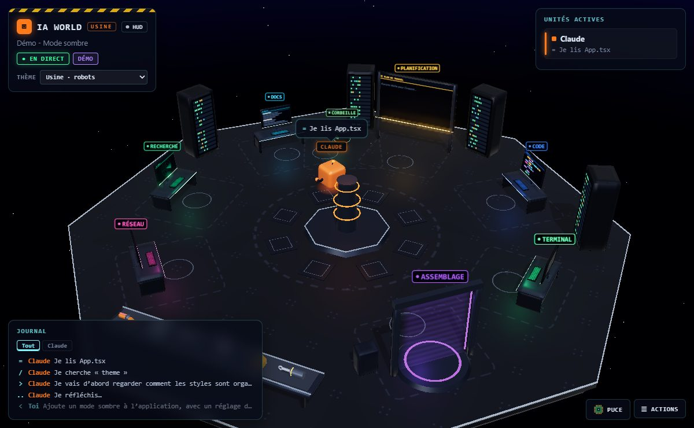
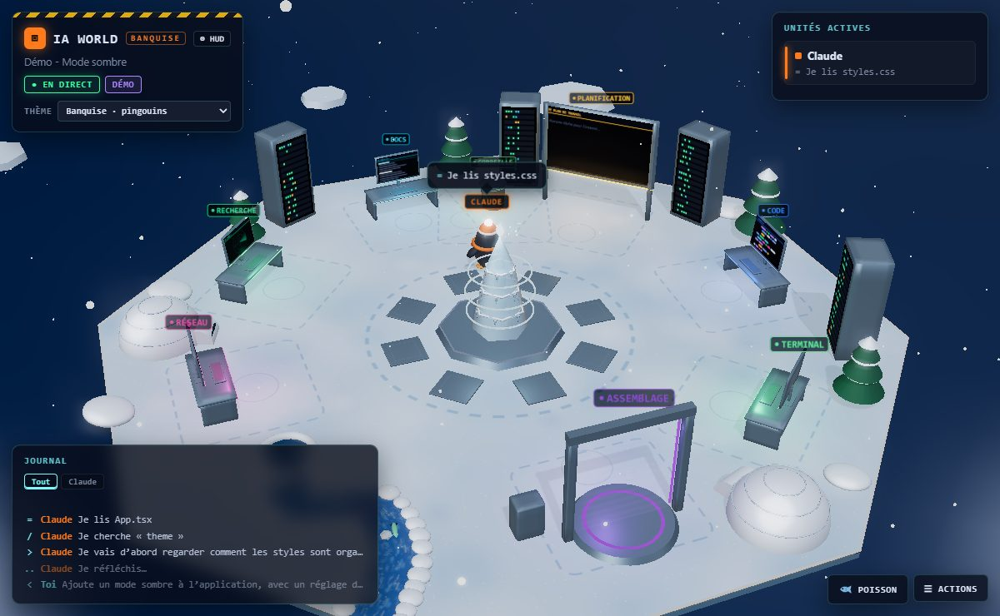
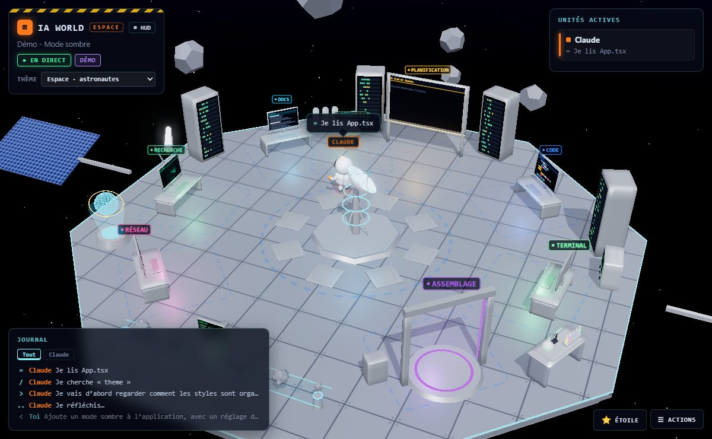
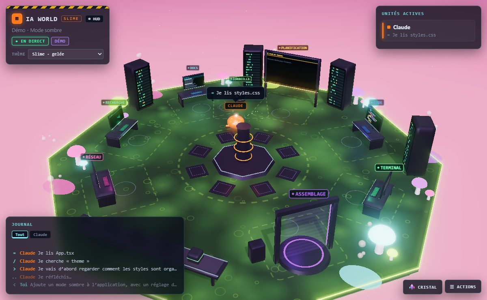
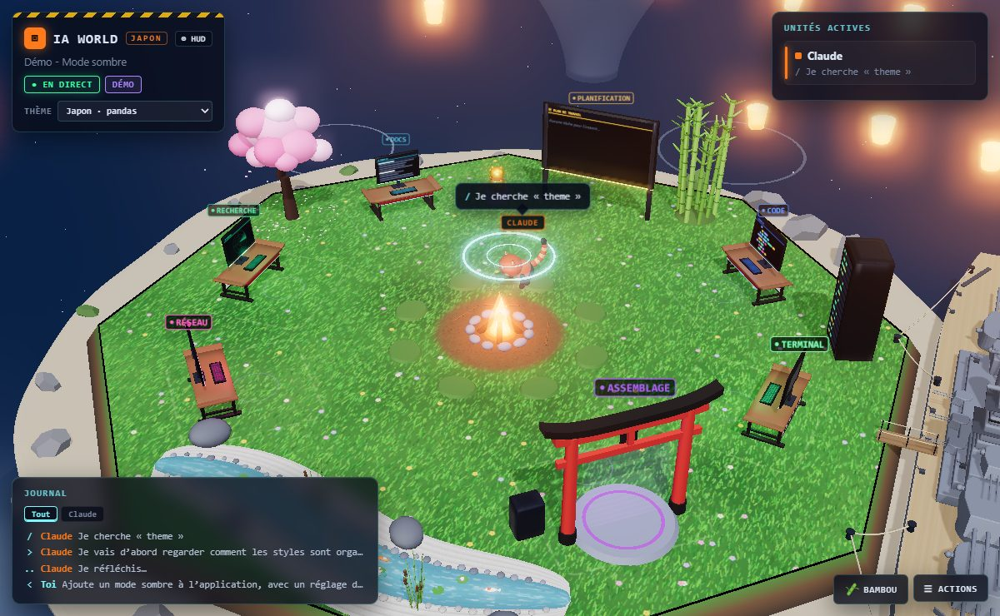
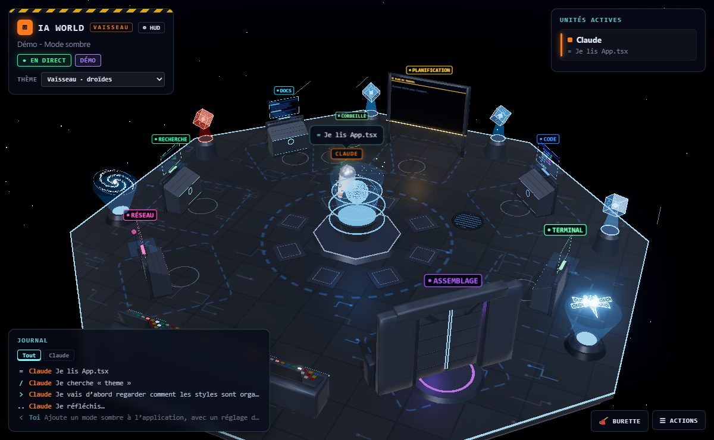

# IA World

**Regardez Claude travailler.** IA World est une extension VS Code qui transforme vos sessions Claude Code
en un petit monde 3D animé : Claude et ses sous-agents y deviennent des personnages qui se déplacent
de poste en poste selon ce qu'ils font, parlent dans des bulles et s'occupent quand ils n'ont rien à faire.



- **Un personnage par session** : plusieurs sessions Claude ouvertes cohabitent dans le même monde.
- **Les sous-agents sont assemblés** dans la baie d'assemblage, avec leur propre couleur, et y retournent
  quand leur mission est terminée.
- **Six univers** au choix, chacun avec ses personnages, son décor, ses cadeaux et ses activités.
- **Lecture seule** : l'extension lit les transcripts que Claude Code écrit déjà ; elle ne change rien
  à sa configuration et ne lui envoie rien.

## Sommaire

- [Installation](#installation)
- [Utilisation](#utilisation)
- [Ce que fait chaque poste](#ce-que-fait-chaque-poste)
- [Interagir avec les personnages](#interagir-avec-les-personnages)
- [Thèmes](#thèmes)
- [Réglages](#réglages)
- [Développement](#développement)
- [Documentation technique](#documentation-technique)

## Installation

Depuis un fichier `.vsix` :

```sh
code --install-extension ia-world-0.1.0.vsix
```

Ou dans VS Code : vue **Extensions** → menu `…` → **Installer depuis VSIX…**.

## Utilisation

| Pour…                                  | Faire                                                                 |
| -------------------------------------- | --------------------------------------------------------------------- |
| Ouvrir le monde                        | cliquer sur **IA World** dans la barre d'état, ou commande **IA World: Ouvrir le monde** |
| Voir une démo sans session Claude      | commande **IA World: Lancer la démo**, ou **Actions → Démo**          |
| Suivre une session précise             | commande **IA World: Choisir la session Claude à suivre**            |
| Changer d'univers                      | menu **Thème** dans le cadre en haut à gauche (le monde se recharge aussitôt) |
| Tourner autour du monde / zoomer       | glisser avec le clic gauche / molette                                 |
| Suivre un personnage                   | cliquer dessus, ou sur sa carte dans **Unités actives**               |
| Masquer l'interface                    | bouton **HUD** (les bulles de parole restent visibles)                |

Le panneau **Actions** (en bas à droite) propose aussi la rotation automatique de la caméra, le recentrage
et un sous-menu **Animations** pour déclencher à la main les animations du personnage suivi.

Par défaut, le monde suit les sessions récentes du workspace ouvert. Un personnage apparaît dès qu'une
session Claude est active et s'en va quand elle se termine.

## Ce que fait chaque poste

| Activité de Claude                                    | Poste          | Ce qui s'affiche                            |
| ----------------------------------------------------- | -------------- | ------------------------------------------- |
| Lire un fichier (`Read`, compétences)                 | DOCS           | le document défile, ligne surlignée         |
| Chercher (`Grep`, `Glob`, `ToolSearch`)               | RECHERCHE      | radar avec la requête                       |
| Écrire ou modifier (`Write`, `Edit`)                  | CODE           | le code s'écrit, nom du fichier             |
| Commande (`Bash`, `PowerShell`)                       | TERMINAL       | la commande et son résultat                 |
| Web et MCP (`WebFetch`, `WebSearch`, `mcp__*`)        | RÉSEAU         | graphe réseau, site consulté                |
| Plan (`TodoWrite`, mode plan)                         | PLANIFICATION  | grand tableau avec la liste des tâches      |
| Lancer un agent (`Agent`, `Task`)                     | ASSEMBLAGE     | un nouveau personnage est assemblé          |
| Supprimer (`rm`, `Remove-Item`, gros retrait de code) | CORBEILLE      | le personnage y jette un fichier ou du code |
| Réfléchir, répondre, poser une question               | sur place      | expressions du visage, bulles               |

Quelques signaux en plus :

- **votre prompt** arrive comme un signal capté par l'antenne du personnage ;
- **une erreur d'outil** le fait fumer ;
- **une interruption** (Échap dans Claude Code) l'arrête net ;
- **la fin d'un tour** se fête d'un saut de joie et de confettis.

Rien n'est réellement supprimé par le monde 3D : la corbeille montre seulement ce que fait Claude.

## Interagir avec les personnages

- **Caresser** : maintenir le clic droit et frotter le personnage avec la souris. Il est content.
- **Offrir un cadeau** : glisser le bouton cadeau (en bas à droite) sur un personnage. Chaque thème a le sien :
  puce, poisson, étoile, cristal, bambou, burette d'huile.
- **Au repos**, les personnages s'occupent seuls : gribouillis au tableau, paniers de papier dans la corbeille,
  balades, et des activités propres à chaque thème (voir ci-dessous).
- **Thème Japon** : cliquer sur une carpe koï la fait sauter hors de l'eau.

## Thèmes

La disposition des postes est la même dans tous les thèmes, pour que l'activité reste lisible d'un univers à l'autre.

| | |
| :---: | :---: |
|  **Usine** · robots cubes laqués, pièces de machines sur le tapis |  **Banquise** · pingouins, tour de glace, rivière, aurore boréale |
|  **Espace** · astronautes, aliens trapus, antenne satellite, astéroïdes passés au scanner |  **Slime** · slimes, marais lumineux, champignons, bulles |
|  **Japon** · pandas, île sur un lac de nuit, feu de camp, torii, mont Fuji |  **Vaisseau** · droïdes, table holographique, holocrons, console de pilotage |

| Thème    | Cadeau          | Activités au repos                                         |
| -------- | --------------- | ---------------------------------------------------------- |
| Usine    | puce            | danse robotique, autodiagnostic                            |
| Banquise | poisson         | glissade sur le ventre, pêche dans la rivière              |
| Espace   | étoile          | réglage de l'antenne, apesanteur, sauts lunaires           |
| Slime    | cristal         | rebonds, division                                          |
| Japon    | bambou          | banane grillée au feu de camp, méditation au bord de l'eau |
| Vaisseau | burette d'huile | jeu de lumières sur la console, tour de dôme, message holographique |

Pour créer votre propre thème, voir [docs/THEMES.md](docs/THEMES.md).

## Réglages

| Réglage                     | Défaut  | Rôle                                                                 |
| --------------------------- | ------- | -------------------------------------------------------------------- |
| `iaworld.theme`             | `usine` | Univers : `usine`, `banquise`, `espace`, `slime`, `japon`, `vaisseau` |
| `iaworld.claudeDir`         | (vide)  | Dossier de configuration Claude ; vide = `$CLAUDE_CONFIG_DIR` ou `~/.claude` |
| `iaworld.followAllProjects` | `false` | Suivre les sessions de tous les projets, pas seulement du workspace  |
| `iaworld.autoOpen`          | `false` | Ouvrir le monde automatiquement quand Claude se met au travail       |

## Développement

Prérequis : Node.js 22 ou plus récent, et VS Code 1.85 ou plus récent.

```sh
npm install
npm run compile   # copie three.js dans media/vendor/, puis compile src/ vers out/
npm run watch     # recompile src/ à chaque modification
npm run lint      # ESLint sur src/, media/js/ et scripts/
npm test          # tests (node:test)
npm run package   # compile, puis produit ia-world-<version>.vsix
```

**F5** dans VS Code ouvre une fenêtre de développement avec l'extension chargée.
Les fichiers de `media/` sont lus directement par la webview, sans étape de compilation :
après une modification, il suffit de fermer et rouvrir le monde, ou de changer de thème.
Seuls les changements dans `src/` demandent `npm run compile`, y compris après un `git pull`.

À chaque push sur `main` et à chaque pull request, la CI GitHub compile, lance ESLint et les tests, et vérifie le contenu du paquet.
Les fins de ligne sont en LF partout (voir `.gitattributes` et `.editorconfig`).

```
src/                 extension VS Code (TypeScript)
  extension.ts       panneau webview, commandes, changement de thème
  watcher.ts         découverte et lecture en continu des transcripts
  transcript.ts      traduction des lignes de transcript en événements
  events.ts          types des événements envoyés au monde
  test/              tests : traduction des transcripts, lecture continue, files d'attente, liste des thèmes
media/
  world.css          interface (HUD, bulles, menus)
  js/main.js         chef d'orchestre : événements → déplacements et animations
  js/queue.js        rythme et plafond des files d'attente des personnages
  js/camera-rig.js   caméra en orbite, suivi d'un personnage
  js/input.js        souris : tourner, zoomer, suivre, caresser, offrir un cadeau
  js/board.js        gribouillis au tableau de planification
  js/station-screens.js  ce qu'affichent les postes pendant le travail
  js/world.js        assemblage de la scène commune, avec ses pièces dans js/world/ :
    layout.js        disposition des postes
    stations.js      postes, tableau, baie d'assemblage, corbeille, borne
    decor.js         plate-forme, sol, serveurs, tapis roulant, ciel
    screens.js       dessins des écrans
  js/character.js    personnage par défaut et son système de poses
  js/hud.js          interface par-dessus la 3D
  js/effects.js      particules (étincelles, fumée, confettis)
  js/geometry.js     géométries et matériaux partagés, outils d'optimisation
  js/themes/<id>/    un dossier par thème
scripts/vendor.js    copie three.js et ses modules dans media/vendor/
```

## Documentation technique

- [docs/ARCHITECTURE.md](docs/ARCHITECTURE.md) : du transcript à l'animation, le protocole entre l'extension
  et la webview, et les choix de performance.
- [docs/THEMES.md](docs/THEMES.md) : créer un thème, pas à pas, avec la liste de tout ce qu'un thème peut remplacer.

## Licence

[MIT](LICENSE)
