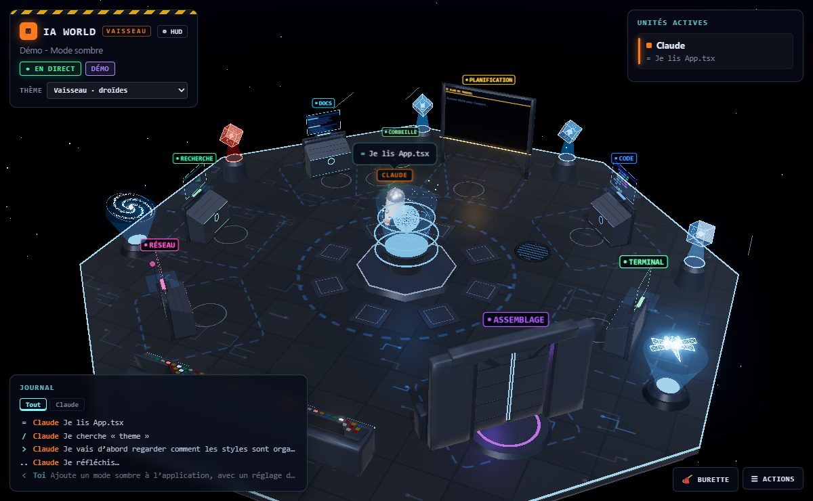

# Créer un thème

Un thème change l'apparence de l'univers et des personnages sans toucher à la logique : les postes
restent aux mêmes endroits et les personnages réagissent aux mêmes événements. Un thème minimal tient
en deux fichiers. Ensuite, on remplace pièce par pièce ce qu'on veut.



## 1. Le thème minimal

```
media/js/themes/foret/
  theme.js      ce que le thème fournit
  hibou.js      le personnage
```

**`theme.js`**

```js
// Thème Forêt : clairière de nuit et hiboux.
import { buildOwl } from './hibou.js';

export default {
  id: 'foret',
  skin: buildOwl,
  shell: 'hibou@foret:~$',
};
```

**`hibou.js`** : `skin(ch)` construit le personnage dans `ch.chassis`. `ch.size` donne sa taille et
`ch.color` sa couleur (celle de la session ou du type d'agent). Les assemblages communs sont dans
[`themes/shared.js`](../media/js/themes/shared.js) :

| Fonction                                     | Rôle                                                     |
| -------------------------------------------- | -------------------------------------------------------- |
| `addGlow(ch, taille, couleur)`               | halo au sol sous le personnage                           |
| `addBody(ch, y)`                             | groupe du corps (celui qui rebondit et s'incline)        |
| `addFace(parent, ch, w, h, x, y, z)`         | visage dessiné : yeux, bouche et expressions viennent tout seuls |
| `addAntenna(parent, ch, y, options)`         | antenne qui capte les prompts                            |
| `addArms(parent, ch, { x, y, elbowY, upper, fore })` | deux bras articulés (épaule, coude)              |

```js
import * as THREE from '../../../vendor/three.module.min.js';
import { mat, mesh, sphere } from '../../geometry.js';
import { addAntenna, addArms, addBody, addFace, addGlow } from '../shared.js';

export function buildOwl(ch) {
  const S = ch.size;
  addGlow(ch, S * 1.4, ch.color);
  const b = addBody(ch, 0.1 + S / 2);
  b.add(mesh(sphere(S / 2, 32, 24), mat(ch.color, { roughness: 0.8 })));
  addFace(b, ch, S * 0.7, S * 0.45, 0, S * 0.1, S / 2 - 0.02);
  addAntenna(b, ch, S / 2);
  const wing = mat('#5a4632');
  addArms(b, ch, {
    x: S / 2, y: 0, elbowY: -0.12,
    upper: (g) => g.add(mesh(sphere(0.06, 12, 8), wing, 0, -0.06, 0)),
    fore: (g) => g.add(mesh(sphere(0.05, 12, 8), wing, 0, -0.05, 0)),
  });
  // hand : hauteur de la main dans l'avant-bras (où tenir les objets) ; top : haut de la tête
  return { hand: -0.1, top: S / 2 + 0.4 };
}
```

## 2. Déclarer le thème

Le nom du thème est vérifié à trois endroits, pour que l'extension refuse une valeur inconnue :

1. [`media/js/themes/index.js`](../media/js/themes/index.js) : ajouter `{ id: 'foret', name: 'Forêt · hiboux' }` à `THEME_LIST`.
2. [`src/extension.ts`](../src/extension.ts) : ajouter `'foret'` à `THEMES`.
3. [`package.json`](../package.json) : ajouter `"foret"` à l'`enum` de `iaworld.theme`, avec sa ligne dans `enumDescriptions`.

Puis `npm test` : il recompile `src/` et vérifie que les trois listes concordent. Choisissez ensuite le thème dans le menu **Thème**.
Pensez aussi à ajouter une ligne au tableau des thèmes du [README](../README.md).

## 3. Ce qu'un thème peut remplacer

Tout est facultatif, sauf `skin` ou `character`. La liste qui fait référence est en tête de
[`themes/index.js`](../media/js/themes/index.js) ; en voici le résumé, avec des exemples à imiter.

### Ambiance

| Clé                                  | Rôle                                               | Exemple        |
| ------------------------------------ | -------------------------------------------------- | -------------- |
| `sky`, `stars`, `fog`                | dégradé du ciel, nombre d'étoiles, brume           | `japon`        |
| `hemi`, `sun`, `exposure`, `bloom`   | lumières, exposition, intensité du halo lumineux   | `banquise`     |
| `floor`                              | sol : `paint(ctx, size, k, px)` pour le peindre, ou couleurs | `japon`, `vaisseau` |
| `platform`, `tint`                   | bord et dessous de la plate-forme, teinte du métal | `japon`        |

### Personnages

| Clé          | Rôle                                                                     | Exemple           |
| ------------ | ------------------------------------------------------------------------ | ----------------- |
| `skin`       | construit le personnage                                                  | `usine/robot.js`  |
| `agentSkin`  | apparence des sous-agents, si elle diffère                               | `espace/rocky.js`, `vaisseau/mouse.js` |
| `character`  | classe entière à la place de `Character`, pour une autre articulation    | `japon/panda.js`  |
| `sleepText`  | texte quand le personnage se repose                                      | `japon`           |

### Pièces du décor

| Clé                        | Remplace                                              | Exemple                  |
| -------------------------- | ----------------------------------------------------- | ------------------------ |
| `tower`                    | la tour centrale : `{ build(groupe) → animate(t), rings }` | `banquise/tower.js`  |
| `dock(groupe, angles, r)`  | tout le socle central                                 | `japon/campfire.js`      |
| `gate`                     | le cadre de la baie d'assemblage ; `build` peut renvoyer `animate(power, t)` | `vaisseau/door.js`, `japon/torii.js` |
| `racks`, `rack(groupe)`    | emplacements et contenu des baies de serveurs         | `vaisseau/holocron.js`   |
| `desk(groupe, couleur)`    | le bureau des postes (écran et clavier gardés)        | `japon/desk.js`          |
| `workstation(st, écran, taille)` | le poste entier ; doit définir `st.keys`        | `vaisseau/port.js`       |
| `conveyor(scene, place)`   | le tapis roulant entier                               | `banquise/river.js`      |
| `conveyorItems`            | seulement les objets posés sur le tapis               | `usine/parts.js`         |
| `decor(scene)`             | décor libre ; renvoie `animate(t, dt)`                | `vaisseau/interior.js`   |
| `trash: 'fire'`            | pas de corbeille : on jette au feu                    | `japon`                  |
| `idleThrow: false`         | pas de paniers de papier au repos                     | `japon`                  |
| `doodles`                  | dessins au tableau                                    | `japon/doodles.js`       |

### Cadeau et activités

**`gift`** : l'objet qu'on glisse sur un personnage.

```js
export const gift = {
  name: 'Gland',                  // bouton
  article: 'un gland',            // « Hibou a reçu un gland »
  svg: '<svg …>…</svg>',          // icône du bouton (texte fixe du thème)
  build: () => new THREE.Group(), // l'objet 3D qui vole jusqu'au personnage
  colors: ['#c98a3a', '#ffffff'], // confettis
  lines: ['Un gland ! Merci <3'], // ce que dit le personnage
};
```

**`actions`** : poses supplémentaires et activités de repos. Les activités apparaissent aussi dans
**Actions → Animations**.

```js
export const actions = {
  poses: {
    hoot: {
      // p : angles des bras (sLx, sLz, eL, sRx, sRz, eR), inclinaison (tiltX, tiltZ), yaw, bob, lift
      pose(p, t) { p.tiltX = Math.sin(t * 6) * 0.15; },
      // f : expression du visage (expr : 'happy', 'focus', …), regard (eyeX, eyeY)
      face(f) { f.expr = 'happy'; },
    },
  },
  idle: [
    {
      label: 'Hululement',          // nom dans le menu Animations
      weight: 1,                    // probabilité relative d'être choisie au repos
      can: (ch) => true,            // facultatif : réservée à certains personnages
      start(ch, tools, s) {         // s : un objet libre pour garder l'état de l'activité
        ch.setAction('hoot');
        tools.say(ch, 'Hou hou !');
      },
      update(ch, dt, time, tools, s) {
        return time > 3;            // true : l'activité est finie
      },
      stop() {},                    // facultatif : ranger ce que l'activité a sorti
    },
  ],
};
```

`tools` donne accès à `say`, `walk`, `randomSpot`, `giftTo`, `effects`, `scene` et `stations`.
Une activité peut être interrompue à tout moment par le vrai travail de Claude : `stop()` doit laisser le décor propre.

## 4. Les bonnes habitudes

**Matériaux et géométries partagés.** Passez par `mat()`, `mesh()`, `sphere()`, `cylinder()` et `roundedBox()`
de [`geometry.js`](../media/js/geometry.js) : ils gardent un cache, donc mille galets de la même couleur
n'ont qu'un matériau.

**Fusionner ce qui ne bouge pas.** Un décor fait de centaines de petites pièces coûte un appel de dessin
par pièce. `mergeStatic(groupe, aGarder)` les regroupe en un maillage par matériau, pour le même rendu :

```js
import { mergeStatic } from '../../geometry.js';

const g = new THREE.Group();
// … rochers, galets, poutres …
mergeStatic(g, [poissons, flamme]); // ce qui est animé reste à part, avec ses enfants
scene.add(g);
```

À utiliser une fois le groupe construit, et seulement pour des pièces qui ne bougeront plus les unes par
rapport aux autres. Les objets cachés et les matériaux transparents sont laissés tels quels. Si une pièce
doit être animée ou cliquable plus tard, mettez-la dans la liste à garder. Le thème Japon en donne des
exemples dans `yamato.js`, `decor.js`, `river.js` et `campfire.js`.

**Ombres.** `trimShadows` passe sur toute la scène après la construction : il retire l'ombre des objets
lumineux et des pièces de moins de 6 cm. Activez `castShadow` seulement sur ce qui doit vraiment projeter une ombre.

**Ne pas toucher à la logique.** Un thème construit et anime ; il ne décide pas où vont les personnages.
Si un thème a besoin d'un nouveau point d'accroche, ajoutez une clé facultative dans `world.js` (ou ses pièces dans `world/`) ou `main.js`,
avec sa valeur par défaut, et documentez-la dans `themes/index.js`.

**Vérifier.** Ouvrez le monde avec **Lancer la démo** : Claude passe par tous les postes, assemble un
agent et jette quelque chose à la corbeille. Testez aussi chaque activité depuis **Actions → Animations**.
